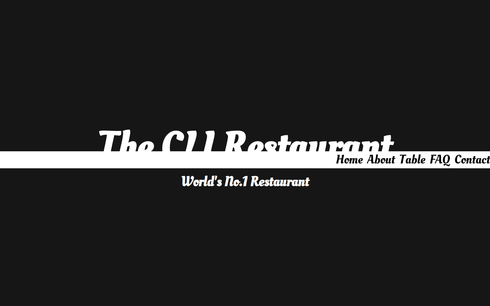
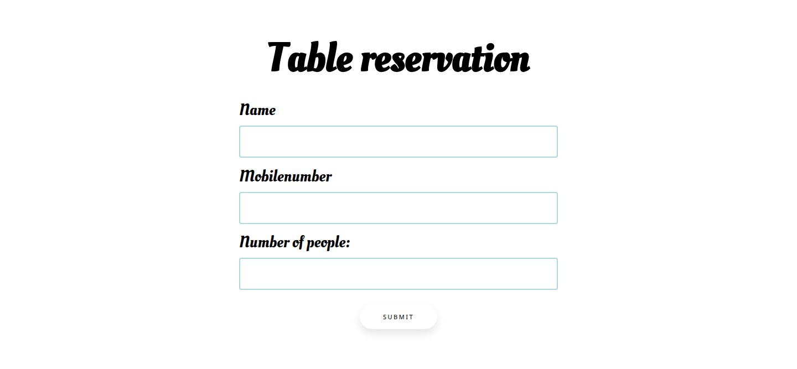
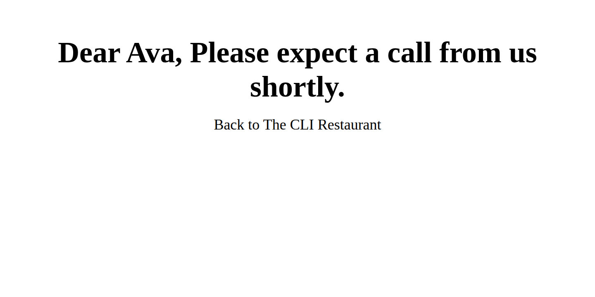
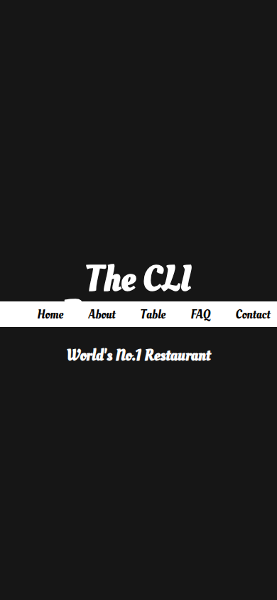
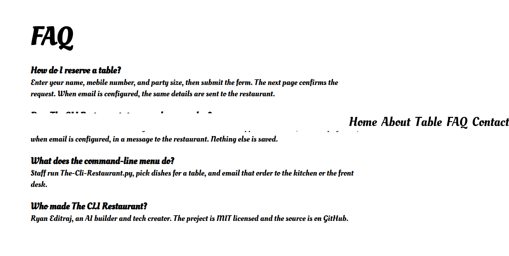
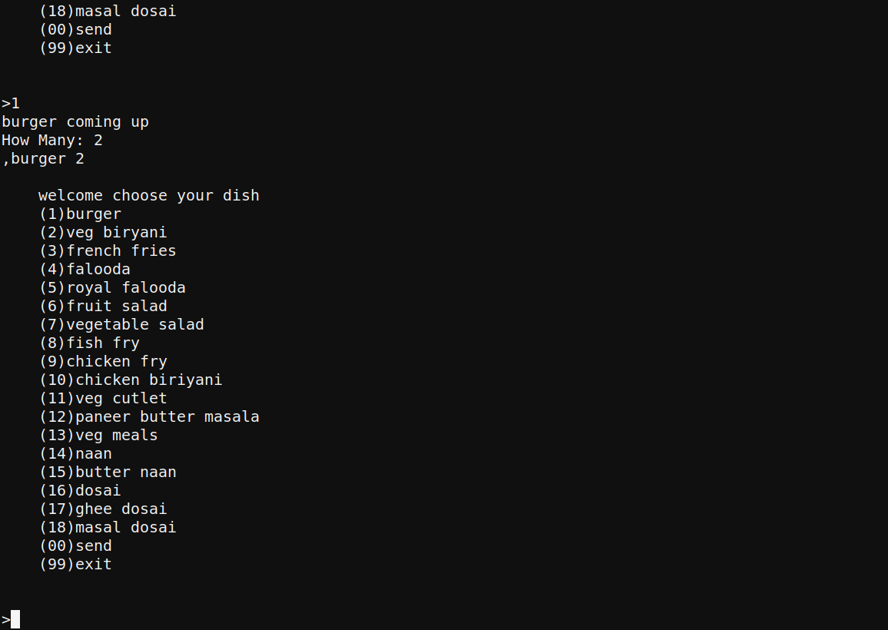

# The CLI Restaurant

**Take the order in the terminal. Book the table in the browser.**

[](https://github.com/ryaneditraj/The-CLI-Restaurant/actions/workflows/ci.yml)
[](LICENSE)
[](https://www.python.org/)
[](https://flask.palletsprojects.com/)

The CLI Restaurant is a free, open-source Python restaurant toolkit by [Ryan Editraj](https://github.com/ryaneditraj). Staff take dine-in orders from an 18-dish command-line menu. Guests request a table on a Flask booking page. When email is configured, the desk gets the reservation and the kitchen gets the order. There is no database and no payment flow. It is MIT licensed.

Started in 2022 as a terminal menu. The table-booking site was added that May.

## Contents

- [Demo](#demo)
- [Features](#features)
- [Tech stack](#tech-stack)
- [Quick start](#quick-start)
- [Usage](#usage)
- [Configuration](#configuration)
- [Project structure](#project-structure)
- [FAQ](#faq)
- [Roadmap](#roadmap)
- [Contributing](#contributing)
- [Security](#security)
- [License](#license)
- [Author](#author)

## Demo

Screenshots below are from a local run of this repository. Email was left unconfigured, so the confirmation page is the on-screen receipt. The hero looks for `static/pic.jpg`, which has never been in the repo, so the banner is the dark fallback.

### Table booking website











### Command-line order pad



## Features

- Terminal order pad with 18 dishes, a table number, and an email of the ticket
- Flask booking page with an about section, reservation form, FAQ, and contact links
- Confirmation page that shows the guest's name
- Optional SMTP email for reservations and orders (Gmail on port 465 by default)
- `new-product.py` prints a snippet you can paste into the menu after you review it
- Separate Flask-Mail demo in `app.py`
- MIT license

## Tech stack

| Piece | Choice |
| --- | --- |
| Language | Python 3.12+ |
| Booking site | Flask 3.1 |
| Templates | Jinja (autoescape on) |
| Mail | `smtplib` in the menu and booking site, Flask-Mail in `app.py` |
| Storage | None. Email is the only copy of a booking |
| Tests | `unittest` |
| CI | GitHub Actions |

## Quick start

```bash
git clone https://github.com/ryaneditraj/The-CLI-Restaurant.git
cd The-CLI-Restaurant
python3 -m venv .venv
source .venv/bin/activate
python -m pip install -r requirements.txt
cp .env.example .env
python server.py
```

Open [http://127.0.0.1:5000](http://127.0.0.1:5000).

On Windows, create and activate the environment with `py -m venv .venv` and `.venv\Scripts\activate`.

You can leave the mailbox values blank. The site still accepts a reservation and shows the confirmation. Fill in `.env` when you want the desk to receive email. Use a Gmail App Password, not your normal login password.

## Usage

### Book a table

1. Run `python server.py`.
2. Open the site and go to **Table**.
3. Enter a name, a mobile number, and how many people.
4. Submit. The next page says the guest should expect a call.

`/sign-up` is a stub and returns `not available`.

### Take an order in the terminal

```bash
python The-Cli-Restaurant.py
```

1. Type a table number.
2. Type a dish number from 1 to 18, then how many.
3. Type `0` to email the ticket and close the app. The menu labels this `(00)`.
4. Type `99` to exit without emailing.

The ticket text is unchanged from the original menu: a two-burger order is stored as `,burger 2`.

The dishes are burger, veg biryani, french fries, falooda, royal falooda, fruit salad, vegetable salad, fish fry, chicken fry, chicken biryani, veg cutlet, paneer butter masala, veg meals, naan, butter naan, dosai, ghee dosai, and masala dosai.

### Add a dish

`python new-product.py` asks for a product number, name, and a Python identifier. It prints a snippet. It does not edit the menu. Read the snippet, then paste it into `The-Cli-Restaurant.py` if it looks right.

### Flask-Mail demo

`python app.py` is not the booking site. It sends one "Hello" message to `RECIPIENT_EMAIL` when mail is configured, and returns a short explanation when it is not.

## Configuration

Copy `.env.example` to `.env`. Real environment variables win over the file.

| Variable | Purpose | Default |
| --- | --- | --- |
| `SENDER_EMAIL` | Mailbox that sends reservations and orders | empty (email skipped) |
| `SENDER_PASSWORD` | Mailbox password or Gmail App Password | empty |
| `RECIPIENT_EMAIL` | Desk or kitchen inbox | empty |
| `SMTP_HOST` | Mail server | `smtp.gmail.com` |
| `SMTP_PORT` | `465` uses SSL. Any other port uses STARTTLS | `465` |
| `SECRET_KEY` | Signs the booking-form cookie | random each process |
| `FLASK_DEBUG` | `1` turns on the debugger. Local only | `0` |
| `HOST` | Bind address | `127.0.0.1` |
| `PORT` | Bind port | `5000` |
| `SITE_URL` | Public origin for canonical, Open Graph, and sitemap links | local host only |

Drop a photo at `static/pic.jpg` if you want it behind the homepage title.

## Project structure

```
.
├── The-Cli-Restaurant.py     # terminal order pad
├── new-product.py            # prints a menu snippet
├── server.py                 # booking website
├── app.py                    # optional Flask-Mail demo
├── config.py                 # .env loader
├── mailer.py                 # SMTP helper
├── seo.py                    # description, FAQ, JSON-LD
├── requirements.txt
├── .env.example
├── robots.txt
├── sitemap.xml               # repo entry; the app serves a host-aware copy
├── llms.txt
├── docs/screenshots/         # captured from a local run
├── static/styles.css
├── static/og-cover.png
├── templates/index.html
├── templates/submitted.html
├── submited.html             # unused early draft
├── templates/sign-up.html    # unused form fragment
├── tests/
└── .github/                  # CI, Dependabot, issue and PR templates
```

## FAQ

### What is The CLI Restaurant?

It is an open-source Python project: a command-line restaurant order pad plus a Flask website where a guest can request a table. It is a demo and a learning project, not a hosted restaurant.

### How do I install it?

Clone the repository, create a virtual environment, and install `requirements.txt`. The quick start above is the whole install. Python 3.12 or newer is what CI runs.

### How do I run the table booking website?

Run `python server.py` and open `http://127.0.0.1:5000`. Submit the form under Table reservation.

### How do I take an order in the terminal?

Run `python The-Cli-Restaurant.py`, enter a table number, pick a dish number, enter a quantity, then `0` to email the ticket or `99` to quit.

### Does The CLI Restaurant use a database?

No. Reservations and orders are not stored. When email is configured, the text of the booking or the ticket is sent to `RECIPIENT_EMAIL`. Otherwise the booking only appears on the confirmation page.

### How do email notifications work?

Set `SENDER_EMAIL`, `SENDER_PASSWORD`, and `RECIPIENT_EMAIL`. The default server is `smtp.gmail.com` on port 465 (SSL). For a Gmail account, create an App Password. The booking site and the terminal menu share those variables.

### Which Python version does it need?

Python 3.12 or newer. GitHub Actions tests 3.12. Flask 3.1 supports older 3.x releases, but this repo's CI target is 3.12.

### How do I add a dish to the command-line menu?

Run `python new-product.py` and paste the printed snippet into `The-Cli-Restaurant.py` after you read it. The generator rejects identifiers that are not plain Python names and escapes quotes in the dish name.

### Is The CLI Restaurant free?

Yes. It is [MIT licensed](LICENSE). You can use, modify, and redistribute it under that license.

### Can I use this for a real restaurant?

You can fork it as a starting point. As it stands, it has no accounts, no payments, no menu prices, and no database. `python server.py` is a development server. A public host should run a WSGI server, set `SECRET_KEY` and `SITE_URL`, keep `FLASK_DEBUG` off, and keep the process on a private network or behind a real web server.

### Who maintains The CLI Restaurant?

[Ryan Editraj](https://github.com/ryaneditraj), an AI builder and tech creator. Instagram: [@ryaneditraj](https://instagram.com/ryaneditraj).

### Why were passwords removed from the code?

A mailbox credential was committed in e2b8b1a and has been rotated. Mail settings now come from the environment. See [SECURITY.md](SECURITY.md).

## Roadmap

- Save reservations somewhere other than an email
- A staff page for today's bookings
- Prices, totals, and a printable ticket in the terminal menu
- One menu file shared by the terminal and the website
- A real hero photo at `static/pic.jpg`
- A public demo deployment
- Stronger bot protection than the in-memory rate limit

## Contributing

See [CONTRIBUTING.md](CONTRIBUTING.md) and the [Code of Conduct](CODE_OF_CONDUCT.md). Bug reports and feature ideas can use the issue templates.

```bash
python -m unittest discover -s tests -v
```

## Security

See [SECURITY.md](SECURITY.md). Report vulnerabilities through [GitHub security advisories](https://github.com/ryaneditraj/The-CLI-Restaurant/security/advisories/new), not in a public issue. Never commit `.env`.

## License

[MIT](LICENSE). Copyright (c) 2022-2026 Ryan Editraj (Ryan-techie).

## Author

**Ryan Editraj** — AI builder and tech creator.

- GitHub: [github.com/ryaneditraj](https://github.com/ryaneditraj)
- Instagram: [instagram.com/ryaneditraj](https://instagram.com/ryaneditraj) (about 295K followers)
